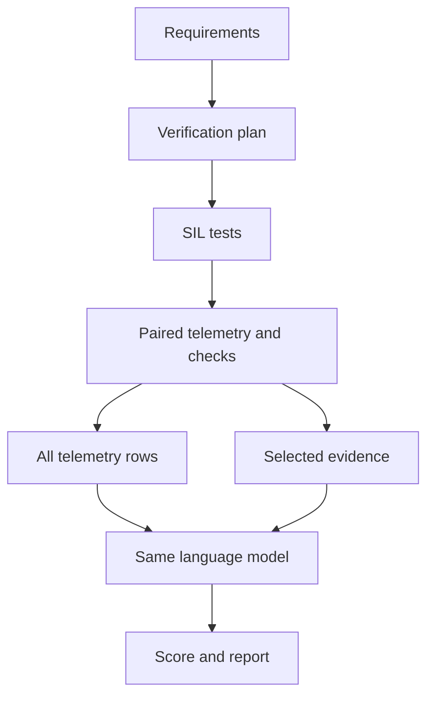

# PropelLab

PropelLab is an autonomous research pipeline for propulsion software validation.
It turns requirements into a verification plan, runs controlled vehicle
simulations, and evaluates AI-assisted failure diagnosis.

The prototype covers conventional engine, battery-electric, and range-extended
electric propulsion. [Related work](docs/related-work.md) explains how the design
maps to Stellantis's published validation workflow.

## Results

- [Short experiment report](results/propellab-pilot/REPORT.md)
- [Metrics and per-run results](results/propellab-pilot/)
- [Accuracy and token comparison](results/propellab-pilot/comparison.png)
- [Selected evidence in a failed test](results/propellab-pilot/example.png)
- [Range-extender coverage improvement](results/propellab-pilot/COVERAGE.md)

Download the results directory to open its interactive dashboard locally.

## Run the agent

Python 3.11 or newer and a C++17 compiler are required. The agent compiles the
controller, prepares the verification plan, runs the software tests, compares
diagnosis methods, retests a generator coverage gap when detected, and writes the
plots, dashboard, report, and raw measurements.

```bash
python -m pip install -e .
python -m unittest discover -s tests -v
python -m propellab study --output local-results/study
```

The default offline run evaluates fixed diagnostic rules and a random forest.
For the published model experiment, supply a CPU build of
[llama.cpp b12289](https://github.com/ggml-org/llama.cpp/releases/tag/b12289)
and the pinned
[Gemma 4 E4B Q4_0 weights](https://huggingface.co/ggml-org/gemma-4-E4B-it-GGUF/tree/27cd6836f8e2a6e5e6b57ea0e77fa72490706985).
The agent starts and stops the local server for this command.

```bash
python -m propellab study --output local-results/model-study \
  --model gemma-4-e4b-it-q4_0 --model-cases 15 \
  --llama-server /path/to/llama-server --gguf /path/to/gemma-4-E4B-it-Q4_0.gguf --threads 7
```

An existing OpenAI-compatible chat server can be used with `--model-url`.
The agent also supports the Responses API with `--api responses`. Provide a
service key through `PROPELLAB_MODEL_API_KEY` when the endpoint requires one.



The two LLM conditions receive the same candidate components, requirements,
and observed-minus-healthy telemetry format. The selector keeps failure anchors,
early signal changes, and high-deviation rows. Scenario seeds are split before
training, and the injected fault is reserved for scoring. Rerunning the same
configuration in the same output directory resumes from saved model responses.

## Physical controller bench

The host and Arduino sketch share one controller implementation. For a Pico
with the Arduino Mbed RP2040 core, compile the sketch in `propellab/bench`,
load it onto the board, and connect the USB serial port.

```bash
python -m pip install -e '.[bench]'
arduino-cli core install arduino:mbed_rp2040
arduino-cli compile --fqbn arduino:mbed_rp2040:pico propellab/bench
python -m propellab bench --port /dev/ttyACM0 --platform BEV
```

The bench command runs healthy and faulted fixtures on the host and the board.
It saves requirement verdict agreement, timing misses, and both traces. The
published experiment measured software-in-the-loop runs. Its requirements and
controllers are research fixtures, and the report calls out the remaining
physical bench validation.

The [Pico firmware](results/propellab-pilot/propellab-pico.uf2) compiled
successfully with the Arduino Mbed RP2040 4.6.0 core.
[Build details and checksum](results/propellab-pilot/firmware_build.json)
identify the binary.
