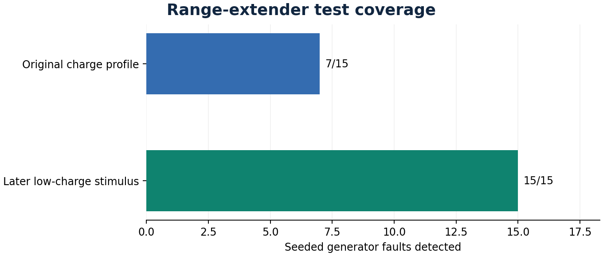

# Range-extender follow-up

Some original tests reached low charge before the seeded generator defect became active. Once the generator was running, those tests could miss a problem with starting it.

The follow-up held charge above the start threshold for the first 30 seconds, then let it fall. On the same **15** scenario seeds, the original test caught **7/15** generator faults. The later stimulus caught **15/15**. The healthy controller passed **15/15** later-stimulus runs.

This exploratory retest checks one defect family on the simulator. The primary diagnosis benchmark retains its original runs.

[Per-run results](coverage_followup.csv) · [Summary](coverage_followup.json)
