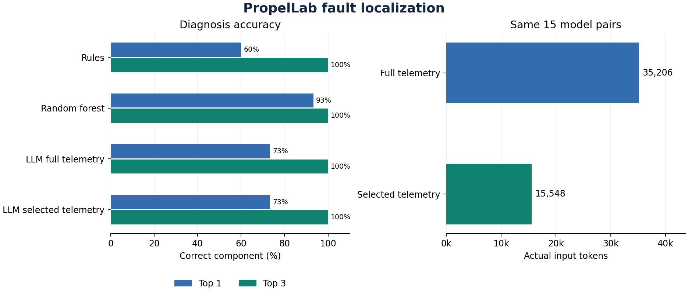
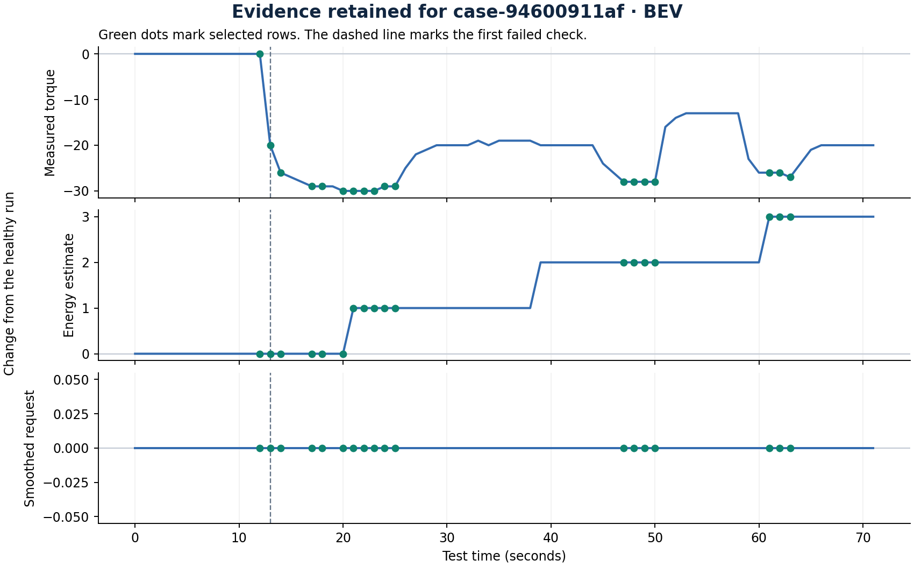
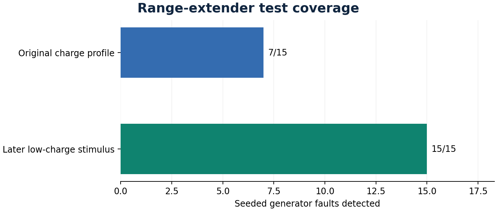

# Short report

PropelLab tests vehicle-control software and ranks the likely faulty component when a requirement fails. This experiment asks how much telemetry an LLM needs to diagnose a failure.

## What ran

The agent ran **375 software-in-the-loop tests** across engine, battery-electric, and range-extended electric vehicles. All three used public EPA driving schedules. **45/45** healthy runs passed. The checks detected **322/330** seeded software faults.

Faults that escaped the requirement checks came from generator supervisor (8). These runs count toward test coverage and are outside the ranking evaluation.

The agent used **gemma-4-e4b-it-q4_0** for the two language-model arms. The verification plan source was **language model**. The full arm received every paired telemetry row. The selected arm received up to 18 rows centered on failures, early changes, and large deviations.

## How well it found the fault

Top 1 means the correct component was first. Top 3 means it was among the first three.
The table uses the same sampled cases across methods when an LLM comparison was requested.

| Method | Cases | Valid outputs | Top 1 | Top 3 | Median model time |
|---|---:|---:|---:|---:|---:|
| Rules | 15 | 15 | 9/15 | 15/15 | NA |
| Random forest | 15 | 15 | 14/15 | 15/15 | NA |
| LLM full telemetry | 15 | 15 | 11/15 | 15/15 | 29.7 s |
| LLM selected telemetry | 15 | 15 | 11/15 | 15/15 | 18.0 s |

Across **15** valid pairs, selected evidence used **15,548** input tokens. Full telemetry used **35,206**. The input-token reduction was **55.8%**.

## One failed run

The seeded cause in **case-94600911af** was **actuator control**.

The selected-evidence model ranked **actuator control** first.
Evidence IDs were E013, E014, E017. The delivered torque (actual) deviates significantly from the requested torque (req) after the torque command (cmd) is issued.

## Improving the generator test

Moving the low-charge stimulus later increased detection from **7/15** to **15/15** on the same scenario seeds. This follow-up keeps the original diagnosis benchmark intact.

[Read the follow-up](COVERAGE.md)

## Scope

The benchmark uses simplified powertrain models, original requirements, and single software faults. The LLM sample is a pilot drawn from held-out scenario seeds. Results describe this simulator. The full arm ran before the selected arm for each case. Timing can reflect runtime caching. A physical board run is still needed to measure hardware-in-the-loop agreement and timing.

[Browse the dashboard](dashboard.html) · [Metrics](summary.json) · [Runs](runs.csv) · [Predictions](predictions.jsonl) · [Telemetry](telemetry.jsonl.gz) · [Research references](../../docs/related-work.md)
